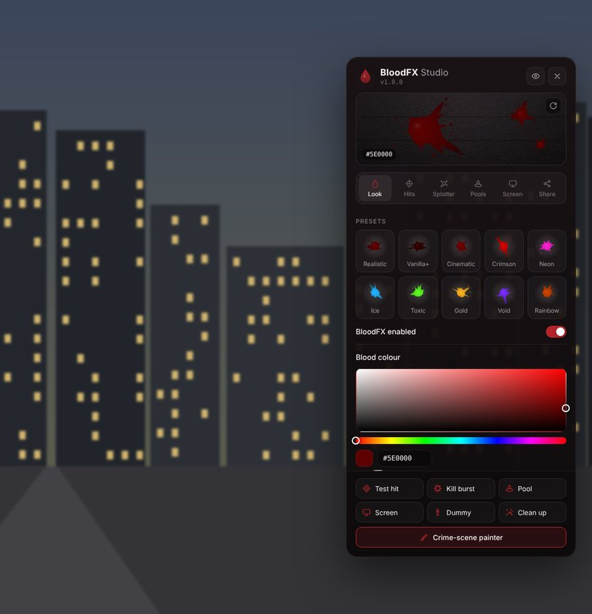
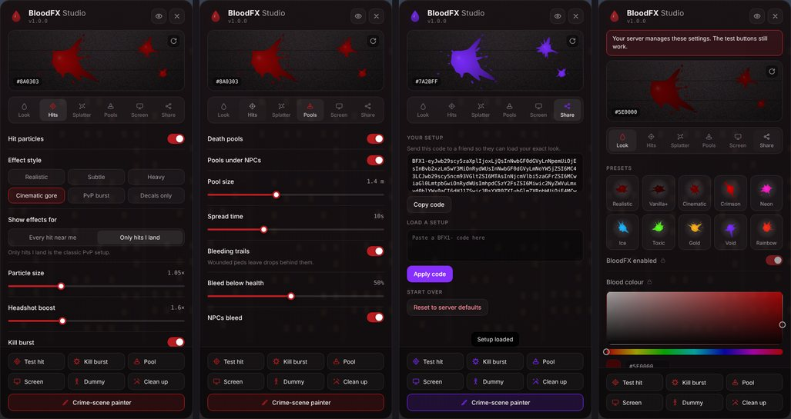
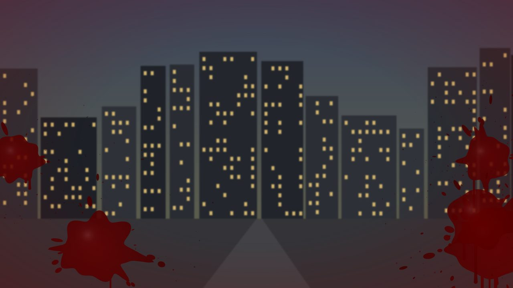

# BloodFX

Custom blood effects for FiveM with an in-game editor. Every player tunes their own blood in **BloodFX Studio**, and staff can paint persistent, synced crime scenes.

No streamed assets and no framework dependency. Every particle effect, decal type and damage pack it uses exists in the base game.



*UI preview rendered in a browser over a stand-in backdrop.*

## Features

- **Hit effects.** Extra entry and exit wounds, headshot bursts and kill bursts. Six styles run from subtle to cinematic gore, plus a decals-only mode.
- **Any colour.** Decals and screen blood use your colour, and rainbow mode cycles through every hue. Particle tint works on the effects that accept one (see [Limits](#notes-and-limits)).
- **Splatter.** Blood sprays onto the wall or floor behind the target and drips on the ground. Explosions and rotor blades throw it in every direction.
- **Death pools** spread under bodies, and **bleeding trails** follow wounded peds.
- **Screen blood** when you are hit, with a low-health pulse and optional camera shake.
- **Splashback.** Close-range hits splash blood onto your own clothes.
- **BloodFX Studio** (`/bloodfx`). Presets, a colour picker, live sliders, test buttons, a test dummy and share codes.
- **Crime-scene painter** (`/bloodpaint`). Place splatters, pools, sprays, mist and drops where you aim. Painted blood is synced to everyone, saved across restarts and permission-gated.
- **Budgets.** Decals and particles are capped per second and in total, so big fights stay smooth.

## Installation

1. Copy the `bloodfx` folder into your server's `resources` directory.
2. Add `ensure bloodfx` to `server.cfg`.
3. Optionally, let staff use the painter:

   ```cfg
   add_ace group.admin bloodfx.paint allow
   add_ace group.admin bloodfx.clean allow
   ```

4. Restart the server, or run `refresh` and then `ensure bloodfx`.

## Commands

| Command | Who | What it does |
| --- | --- | --- |
| `/bloodfx` | Everyone | Opens BloodFX Studio. Bind it under Settings > Key Bindings > FiveM. |
| `/cleanblood` | Everyone | Wipes the blood off your character. |
| `/bloodpaint` | `bloodfx.paint` | Turns the crime-scene painter on or off. |
| `/bloodclean [radius]` | `bloodfx.clean` or `bloodfx.paint` | Removes blood around you for everyone. The radius defaults to 10 m and is capped at 100 m. |
| `bloodfx_clearall` | Server console | Removes all painted blood. |

Rename or disable commands in `Config.Commands`. Set `Config.OpenKey` (for example `'F7'`) to give the studio a default key.

### Painter controls

| Input | Action |
| --- | --- |
| Left mouse | Place |
| E | Next type: splatter, pool, spray, mist, drops |
| Mouse wheel | Bigger or smaller |
| R | Rotate |
| G | Undo your last placement |
| Backspace | Exit |

A see-through preview shows exactly what will be placed.

## The studio



- **Look.** Presets, blood colour, rainbow mode, particle tint and decal opacity.
- **Hits.** Effect style, whose hits you see, particle size, headshot boost, kill burst and splashback.
- **Splatter.** Wall spray, ground drops, chance, size, reach and how long decals last.
- **Pools.** Death pools, spread time, bleeding trails and the health level where bleeding starts.
- **Screen.** Screen blood intensity and duration, the low-health pulse and camera shake.
- **Share.** Copy your setup as a `BFX1-` code, paste a friend's code, or reset to the server defaults.

The footer test buttons play a hit, a kill burst, a pool or screen blood without needing a fight. **Dummy** spawns a local test ped that only you can see. The eye icon detaches the panel: the cursor goes away so you can shoot the dummy and watch your changes, and pressing the studio key again brings the cursor back.

Settings save automatically on each player's PC.



## Configuration

`config.lua` is shared by client and server. `server/sv_config.lua` holds the permission checks.

| Setting | Purpose |
| --- | --- |
| `Config.Defaults` | What every player starts with. |
| `Config.AllowPlayerCustomization` | `false` locks every setting to the defaults. Test buttons still work. |
| `Config.LockedSettings` | Locks single settings or whole sections. `{ 'color', 'rainbow', 'tint' }` keeps blood realistic, and `{ 'pools' }` locks all pool settings. |
| `Config.Limits` | Tightens slider ranges, for example `{ ['hit.scale'] = { max = 1.5 } }`. |
| `Config.Presets` | The one-click looks in the studio. |
| `Config.HitStyles` | Particle layers for each style. |
| `Config.WeaponEffects` | Particles for melee, blades, vehicles, explosions and rotor blades. |
| `Config.Performance` | Ranges and per-second budgets. |
| `Config.Pools`, `Config.Bleeding`, `Config.Splashback` | Fine tuning for those features. |
| `Config.IsPedDowned` | A hook for death systems that keep players alive while they look dead. |
| `Config.Painter`, `Config.Scenes` | Painter types and sizes, a forced colour, persistence, expiry and caps. |

### Framework permissions

Replace the two functions in `server/sv_config.lua`. For example, to let QBCore police paint:

```lua
local QBCore = exports['qb-core']:GetCoreObject()

function SvConfig.CanPaint(source)
    local player = QBCore.Functions.GetPlayer(source)
    return player ~= nil and player.PlayerData.job.name == 'police'
end
```

### Death systems that keep players alive

Many ambulance scripts keep a "dead" player alive and play an animation instead. Tell BloodFX how to recognise that state so the player gets a pool. For qb-ambulancejob:

```lua
Config.IsPedDowned = function(ped)
    return IsEntityPlayingAnim(ped, 'dead', 'dead_a', 3)
end
```

### Adding your own effects

A style is a list of particle layers:

```lua
{ asset = 'core', names = { 'blood_exit' }, scale = 1.3, dir = 'forward', offset = 0.12, chance = 0.6 }
```

- `names` are tried in order until one starts.
- `dir` is `'back'` (toward the shooter), `'forward'` (along the bullet), `'up'` or `'none'`.
- `axis = 'y'` is for effects authored along their Y axis.

Find effect names in [DurtyFree's particle effect dump](https://github.com/DurtyFree/gta-v-data-dumps/blob/master/particleEffectsCompact.json). Set `Config.Debug = true` to log effects that never start.

## Exports

### Client

```lua
exports.bloodfx:OpenStudio()
exports.bloodfx:HitEffect(ped, { weapon = `WEAPON_PISTOL`, headshot = true, fatal = false })
exports.bloodfx:Splatter(vector3(x, y, z), 0.8, '#5e0000')  -- size and colour are optional
exports.bloodfx:Pool(vector3(x, y, z), 1.5)
exports.bloodfx:ScreenBlood(1.0, '#5e0000')
local removed = exports.bloodfx:ClearArea(vector3(x, y, z), 10.0)
local settings = exports.bloodfx:GetSettings()                 -- flat table: settings['hit.scale']
exports.bloodfx:SetSettings({ ['hit.scale'] = 1.5 })
```

### Server

```lua
local id = exports.bloodfx:AddScene(vector3(x, y, z), 'pool', 1.5, {
    color = '#3a0000', normal = vector3(0.0, 0.0, 1.0), angle = 0.0, opacity = 1.0,
})
exports.bloodfx:RemoveScene(id)
local removed = exports.bloodfx:RemoveScenesNear(vector3(x, y, z), 10.0)
local scenes = exports.bloodfx:GetScenes()
```

Scene types are `splatter`, `pool`, `spray`, `mist` and `drops`. They are defined in `Config.Painter.kinds`.

## Notes and limits

- **Particle tint.** GTA only lets scripts recolour some particle effects, so tinted blood shows best with bright colours. Effects that ignore the tint stay dark red, while decals and screen blood always follow your colour. Fully recoloured particles need an edited particle pack (`.ypt`), which this resource does not ship.
- **Per player.** Hit effects are drawn on each player's own client, so everyone sees their own colour and style. Painted crime scenes look the same for everyone.
- **Range.** Your client shows effects for the damage events it receives, within `Config.Performance.effectRange`.
- **Collision.** Decals only stick to loaded collision, so painted blood is drawn within `Config.Scenes.streamDistance`.

## Troubleshooting

- **No painter button in the studio.** Your player lacks `bloodfx.paint`. Check the `add_ace` lines, or your `SvConfig.CanPaint` function.
- **No pool when players "die".** Your death system keeps them alive. Set `Config.IsPedDowned`.
- **An effect never appears.** Set `Config.Debug = true`, reproduce it, and read the F8 console.
- **Too much blood on a busy server.** Lower `Config.Performance.maxDecals`, `maxDecalsPerSecond` or `effectRange`, or shorten `splatter.lifetime` in `Config.Defaults`.

## Files

| Path | Contents |
| --- | --- |
| `config.lua` | Everything a server owner normally edits. |
| `shared/` | Helpers and the settings schema that validates every value. |
| `client/` | Effects, hits, pools, painted scenes, painter, studio and exports. |
| `server/` | Painted-blood storage, validation, sync and permissions. |
| `html/` | The studio UI and the screen-blood overlay. |
| `data/scenes.json` | Saved painted blood. |
